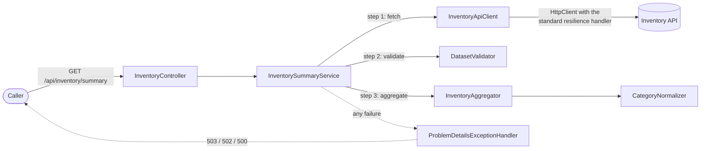

# Inventory Aggregation Service

A small .NET 10 web service with one endpoint. It fetches every page of records from the
Inventory API and checks that the Dataset is complete and internally consistent. Then it
reports the records grouped by category: for each category, the total inventory value, the
available record count, the most recently updated record, and the records behind those
figures.

The Inventory API is paginated, rate-limited and not perfectly well behaved, and coping with
that is most of the work here. [`docs/inventory-api-findings.md`](docs/inventory-api-findings.md)
records what the Inventory API actually does. [`GLOSSARY.md`](GLOSSARY.md) defines the terms
used below, such as Record, Repeated Record, Dataset, Available Record and Category Summary.

## Setup and run

### Prerequisites

- The [.NET 10 SDK](https://dotnet.microsoft.com/download/dotnet/10.0). Check with
  `dotnet --version`.
- The Inventory API's base URL and API key, which come with the assignment email.

```sh
git clone https://github.com/bushscott/inventory-aggregation-service.git
cd inventory-aggregation-service
```

Run every command below from the repository root.

### Configure the API key

The base URL and API key are never committed. Store them as .NET user secrets:

```sh
dotnet user-secrets set "InventoryApi:BaseUrl" "<base URL>" --project src/InventoryAggregation.Api
dotnet user-secrets set "InventoryApi:ApiKey" "<API key>" --project src/InventoryAggregation.Api
```

The base URL is the Inventory API's root, for example `https://host`. A trailing slash is
fine, and any path is ignored, because the service always requests `/api/records`.

**Or use environment variables**, which take priority over user secrets:

```sh
# macOS / Linux
export InventoryApi__BaseUrl="<base URL>"
export InventoryApi__ApiKey="<API key>"
```

```powershell
# Windows PowerShell
$env:InventoryApi__BaseUrl = "<base URL>"
$env:InventoryApi__ApiKey = "<API key>"
```

| Setting | Required | Default | Notes |
|---|---|---|---|
| `InventoryApi:BaseUrl` | Yes | | The Inventory API's root URL. |
| `InventoryApi:ApiKey` | Yes | | Sent in the `X-Api-Key` header. |
| `InventoryApi:PageSize` | No | 25 | Records per page. 25 is the most the Inventory API allows. |

If the base URL or the key is missing, the service refuses to start. Its error names the
missing setting and the command that sets it.

### Run the service

```sh
dotnet run --project src/InventoryAggregation.Api
```

The service listens on `http://localhost:5080` in the Development environment. Both come
from the `http` launch profile, and user secrets are only loaded in Development. Run any
other way, such as the built DLL or `dotnet run --no-launch-profile`, and the service runs in
Production. There, configure it with environment variables, and pass `--urls
http://localhost:5080` to keep the same port, because Kestrel's default is 5000.

### Run the tests

```sh
dotnet test
```

The tests take a few seconds and need no network and no API key. A hand-written fake
Inventory API stands in for the real one, and the tests run in a "Testing" environment where
user secrets are never loaded.

### Call the endpoint

```sh
curl http://localhost:5080/api/inventory/summary
```

Expect the response to take about 10 seconds. A full fetch needs 7 pages, but the Inventory
API allows only 5 requests per 10 seconds, so every call waits out one rate-limit window.
In Rider or Visual Studio,
[`InventoryAggregation.Api.http`](src/InventoryAggregation.Api/InventoryAggregation.Api.http)
sends the same request.

A successful response is `200` with one Category Summary per category. Here it is with the
Electronics summary cut to one of its 25 records:

```json
{
  "categories": [
    {
      "category": "Electronics",
      "totalInventoryValue": 18253.18,
      "availableRecordCount": 25,
      "mostRecentlyUpdated": {
        "id": 1037,
        "name": "Barcode Scanner MK-1037",
        "lastUpdated": "2026-09-23T17:05:00Z"
      },
      "items": [
        {
          "id": 1016,
          "name": "Label Printer MK-1016",
          "price": 53.74,
          "quantity": 14,
          "lastUpdated": "2026-09-20T01:10:00Z"
        }
      ]
    }
  ]
}
```

The shape and field names are the ones the assignment sketches. The differences are
deliberate, and [Business rules and the response](#business-rules-and-the-response) gives
the reason for each:

- `mostRecentlyUpdated` can be `null`, and so can a record's `name` and `lastUpdated`.
- `totalInventoryValue` is exact, never rounded.
- Categories and their records keep the order the records arrived in.
- A category with no available records, such as Discontinued, is left out.

When no summary can be produced, the response is problem details (RFC 9457), always as JSON:

| Status | Title | When |
|---|---|---|
| `503` | Inventory API unavailable | The Inventory API could not be reached, timed out or answered with an error status, even after retries. |
| `502` | Invalid dataset | The Inventory API answered, but its response could not be read or the Dataset failed a check. |
| `500` | Unexpected error | Anything else. The detail is generic, so no internals leak. |

```json
{
  "title": "Invalid dataset",
  "status": 502,
  "detail": "The Inventory API's page 3 reported page size 20, but 25 was requested.",
  "traceId": "00-5f1c…-01"
}
```

The `detail` says what was expected and what arrived. A caller can quote the `traceId` when
reporting a problem.

## Architecture



A request runs three steps in order, and each step is one class:

1. **Fetch.** `InventoryApiClient`, behind the `IInventoryApiClient` interface, is the only
   code that knows HTTP exists. It requests pages one after another, from page 1 up to the
   page count that page 1 reports. It uses a named `HttpClient` from `IHttpClientFactory`,
   with Microsoft's standard resilience handler. When a request fails (an error status, a
   connection failure, a timeout or an unreadable response), the client throws one of two
   exceptions: `InventoryApiUnavailableException` or `InvalidDatasetException`.
2. **Validate.** `DatasetValidator` is a plain class with no HTTP. It checks that the
   pages make a complete, consistent Dataset and removes Repeated Records. It returns the
   unique records, or throws `InvalidDatasetException`.
3. **Aggregate.** `InventoryAggregator`, with `CategoryNormalizer`, is a plain class with
   no HTTP. It turns records into Category Summaries.

`InventorySummaryService` runs the steps and logs the fetch, and the controller calls only
the service. `ProblemDetailsExceptionHandler` is the one place a failure becomes a
response. It maps the two exceptions to 503 and 502, maps everything else to 500, and logs
each failure once. All services are registered with dependency injection and hold no state.

**Why split it here.** The assignment asks for API communication to be kept apart from
business logic, so the aggregation can be tested without HTTP. Checking the Dataset is kept
apart from aggregating it too, because the two change for different reasons. A change in how
the Inventory API behaves lands in the client or the validator, while a new business rule
lands in the aggregator. Each of these classes can be tested with hand-built input, and the
interface around the client is where a cache would go. Failures travel as two exception
types to one handler, so no other code catches and translates errors.

## Decisions and assumptions

Where the assignment left something open, this is what I chose and why. These are the
decisions that most shape the result, each explained in the sections below:

- A negative quantity is treated like a quantity of 0: the record is left out, but it is
  not an error.
- Categories are a closed list of six. Category text that matches none of them fails the
  request, instead of quietly becoming a new category.
- A category with no available records is left out of the response.
- Most recently updated is `null` when no available record has a last-updated time. On a
  tie, the record that arrived first wins.
- Money is exact: `decimal`, never rounded.
- A `200` is not trusted. The Dataset is checked for completeness and consistency before
  anything is aggregated, and a failed check fails the request.
- Identical copies of a Repeated Record are kept once. Copies that differ fail the request.
- A 503 means the Inventory API could not answer, so trying again later may work. A 502
  means it answered with something wrong, so retrying will not help.

### Business rules and the response

- **Negative quantities count as unavailable.** The brief excludes quantity 0. A negative
  quantity is a stock discrepancy, and counting it would reduce a category's value. So
  records with a negative quantity are left out of every figure, but are not an error.
- **Categories are a closed list.** The six known categories are an enum. Category text
  that matches none of them is an Unknown Category, and fails the request with a 502 naming
  the text. That way a new or misspelled category gets noticed, instead of quietly becoming
  a new category. To add a category, add it to the enum, plus a display name if its name has
  a space or a symbol.
- **Every record's category is checked**, including records with no stock, so an Unknown
  Category always fails the request. The check happens in the aggregator, as each record's
  category is matched. Moving it into the validator would mean a second record type, with no
  difference a caller could see.
- **Category text is matched ignoring letter case and surrounding whitespace** (spaces,
  tabs, line breaks). The Inventory API uses 36 spellings of 6 categories. Whitespace is not
  a misspelling, so ignoring it is safe. Nothing else is guessed at.
- **Each category is shown under one fixed name**, such as "Home & Kitchen", whichever
  spelling its records used. The six names are kept in `Category.cs`.
- **A category with no available records is left out**, so a caller is never shown a
  Category Summary with nothing in it.
- **Most recently updated:**
  - Times are compared as instants, so `+02:00` and `Z` times compete fairly.
  - A record with no last-updated time is never chosen, but it still counts towards the
    value, the count and the records listed.
  - If no available record has a time, the result is `null`, rather than a choice with no
    evidence behind it.
  - On a tie, the record that arrived first wins. The brief gives no rule, and arrival order
    is simple and predictable. The test
    `ChoosesTheFirstToArriveWhenRecordsShareTheLatestLastUpdatedTime` pins it, because
    `MaxBy`'s documentation does not promise it.
- **Money is exact.** Totals are `decimal` and never rounded. A `double` cannot hold most
  prices exactly, and its errors add up in a sum. Rounding is left to whoever displays the
  figure.
- **No sorting.** Categories and their records keep the order the records arrived in. The
  brief asks for no order, and arrival order is stable, because the Dataset is static and the
  Inventory API returns it in the same order every time.
- **Timestamps are written in UTC with a `Z` suffix**, the format the Inventory API uses,
  so a caller can compare them directly.

### Getting a complete and correct Dataset

- **Pages are fetched one after another at page size 25**, the largest allowed, which
  makes the fewest requests (7). Fetching in parallel would gain nothing under a limit of 5
  requests per 10 seconds.
- **The fetch stops at the page count page 1 reports.** Past the last page the Inventory
  API answers `200` with no records, so a loop that runs until it gets an error would never
  stop.
- **Requests are not paced to avoid the rate limit.** The one 429 per fetch is left to the
  resilience handler, which waits out `Retry-After`. That is simpler, and pacing would not
  make the fetch any faster.
- **A `200` is not trusted.** Before anything is aggregated, `DatasetValidator` checks the
  following, in this order. The first failure wins, as a 502:
  1. Each page's page number and page size match what was requested, and its total pages
     and total records match page 1's.
  2. The number of pages fetched equals the reported total pages.
  3. No record has a negative price, and copies of a Repeated Record are identical.
  4. The number of unique records equals the reported total records.
- **There is deliberately no check that a page holds exactly the page size.** The Inventory
  API repeats a record at the start of every even page, so those pages hold one extra
  record.
- **Repeated Records:**
  - Identical copies are kept once, at the position where the first copy arrived. That
    position matters, because ties for most recently updated go to the first record to
    arrive.
  - Copies that differ fail the request, naming the record, because there is no way to
    know which copy is right.
  - "Identical" uses C# record equality on every field, so there is no field list to keep
    up to date. A price of `1.0` equals `1.00`, and two times naming the same instant are
    equal whatever their offsets. Category text must match exactly, though: copies spelled
    `"Toys"` and `" toys"` count as differing and fail, even though both spellings match the
    Toys category.
  - A record repeated within one page is treated the same way as one repeated across pages.
- **A negative price fails the request, naming the record**, because a price below zero is
  impossible and would distort a total. The message writes the price as the Inventory API
  does (`-0.01`), whatever the server's culture.
- **Accepted without complaint:** a negative quantity (see above), a blank or `null` name,
  and a `null` last-updated time. None of them makes a figure wrong: the first is left out,
  and records with the other two still count.
- **Reading is strict.** A number written as text (`"price": "19.99"`) fails. A missing
  field also fails, where .NET would otherwise read it as 0. `name`, `category` and
  `lastUpdated` must be present. `name` and `lastUpdated` may be `null`. A `null`
  `category` gets past reading, but then fails the category check as a missing category.
  `null` in place of a page, its records list or a record also fails, naming the JSON path.
  All of these are 502s, so a malformed response is never read as something plausible.

### Errors

- **503 or 502.** When the Inventory API cannot give an answer, that is a 503, because the
  problem may well be temporary and trying again later may work. When it answers but the
  response cannot be read or the Dataset fails a check, that is a 502, because retrying will
  not help until the Inventory API is fixed. Anything else is a 500 with a generic detail.
- **Any error status from the Inventory API is a 503, including a 400 or a 401.** Our caller
  did not cause it and cannot fix it. The detail names the status.
- **Every message about a page names the page**, such as "The Inventory API answered page 3
  with status 500 (InternalServerError).", so it is clear which of the 7 requests failed. An
  Unknown Category message names no page, because categories are matched after the pages
  are combined.
- **Error responses are always JSON problem details**, whatever the caller's `Accept` header
  says, as the success response is. They carry `title`, `status`, `detail` and `traceId`.
- **When our own caller cancels the request**, that is not reported as an Inventory API
  timeout.

### Resilience

- **Microsoft's standard resilience handler**, `AddStandardResilienceHandler()` from
  `Microsoft.Extensions.Http.Resilience` 10.11.1 (the latest 10.x, matching .NET 10, and
  built on Polly 8). It is one line and supported by Microsoft. Its defaults already do what
  this service needs, so they are unchanged apart from the log level (below). This is what
  it does, with the defaults printed from the library's options object:
  - **Retries temporary failures.** A 5xx, a 408, a 429, a connection failure and a
    timed-out attempt are retried up to 3 times, so 4 attempts in all.
  - **Fails fast on the rest.** Other 4xx responses, such as a 400 or a 401, are not
    retried, because retrying cannot fix them and would use up rate-limit quota.
  - **Honours `Retry-After`.** A 429's `Retry-After` header is waited out before the retry.
    Against the real Inventory API, this is where the 10 seconds go.
  - **Backs off.** Without `Retry-After`, retries wait an exponentially growing delay with
    random jitter, starting at about 2 seconds.
  - **Times out.** Each attempt gets 10 seconds, and each page request, retries included,
    gets 30. So an unreasonable `Retry-After` fails cleanly as a 503 instead of hanging.
  - **Logs each retry** as a warning with its reason, for example
    `Resilience event occurred. EventName: 'OnRetry', … Result: '429'`.
  - **Circuit breaker and concurrency limiter.** These are also part of the handler, but
    neither can trigger during a single call. The breaker needs at least 100 requests in 30
    seconds, and the limiter allows 1,000 at once, while a full fetch makes about 8, one at a
    time. Many simultaneous calls are another matter, as the known limitations say.

  `InventoryApiClientRetryTests` tests each behaviour this service relies on. That covers
  retrying a 500, a 503, a connection failure and a timed-out attempt; failing fast on a 400
  and a 401; waiting out `Retry-After`; and logging each retry. When the retries run out,
  the client throws `InventoryApiUnavailableException`, which reaches the caller as a 503
  naming the page and the status.
- **The handler's log entries are capped at warning.** By default it logs the attempt that
  uses up the last retry as an error. The central handler already logs that failure as an
  error with its full cause, so without the cap each failure appeared twice. The cap changes
  only logging, not retries or timeouts.
- **Two kinds of timeout are caught.** The handler's own timeouts cover only the wait for
  the response headers. A body that stalls after the headers arrive is stopped by
  `HttpClient`'s 100-second timeout. That arrives as a different exception, so the client
  catches it too.

### Platform, configuration and logging

- **.NET 10**, the current long-term-support release, with one web project and one test
  project.
- **A classic controller with one action** (`GET /api/inventory/summary`), because it is a
  conventional shape that any .NET reviewer can find their way around.
- **Plain HTTP only.** It runs locally, with no HTTPS redirection, authentication or
  OpenAPI document.
- **Port 5080**, because 5000 is often taken by macOS's AirPlay Receiver.
- **Secrets stay out of the repository.** They live in user secrets locally, and environment
  variables work anywhere.
- **Settings are checked at startup** (`[Required]` and `ValidateOnStart`). A missing setting
  stops the service before it takes a request, with a message naming the setting.
- **The base URL is a `string` setting, not a `Uri`.** As a `Uri` property, an empty
  setting would bind as an empty relative `Uri` and get past `[Required]`.
- **Logging uses `ILogger` with the default console output.**
  - Each fetch is logged at information level, once its Dataset passes validation, for
    example `Fetched the dataset from the Inventory API. Pages: 7, unique records: 157,
    repeated records removed: 3, time taken: 10560 ms.` Its unique-record and
    repeated-record figures only mean something for a valid Dataset.
  - Retries are logged as warnings.
  - Each failure is logged once, as an error with its full cause, by the central handler.

### Testing

- **xUnit v2 with its built-in assertions, one hand-written fake Inventory API, and no
  mocking library.** xUnit v2 is what the SDK's own template uses, which keeps the tests
  simple. The fake plays back scripted responses (such as "500, then 200") and records the
  requests it receives.
- **Tests cover five places**, each through its public entry point:
  - the category normalizer;
  - the validator, with hand-built pages;
  - the aggregator, with hand-built records;
  - the client, through a real `HttpClient` with the real resilience setup over the fake;
  - the whole app running in memory over the fake.
- **Expected values are written out**, as literals or worked examples, rather than
  recomputed the way the code computes them.
- **Tests retry without delay**, so the suite stays fast, but `Retry-After` is still
  honoured. One test waits a real second to prove it.

## Known limitations and next steps

- **No caching, so every call takes about 10 seconds.** Each call to the endpoint does a
  full fetch: 7 pages plus one retry after the 429, about 8 requests in all. The brief says
  the Dataset is static, so caching it with an expiry behind `IInventoryApiClient` would make
  repeat calls instant. This is the first thing I would add.
- **Simultaneous calls share the Inventory API's rate limit.** The limit is 5 requests per
  10 seconds per API key, and every call does its own full fetch. So calls made at the same
  time slow each other down, and enough of them would use up their retries and fail with
  503s. With many more, the circuit breaker, which every call shares, could open, and the
  calls it rejects would get a 500. I worked this out from the code and have not tested it.
  A cache would fix this too, as long as simultaneous calls share one fetch.
- **The page count from page 1 is trusted with no upper bound.** A huge count would mean
  requesting empty pages until it is reached. A sanity cap would stop that.
- **An empty inventory would give a 502, not an empty summary.** If page 1 reported 0 total
  pages, the client would still have fetched page 1, so the page-count check would fail.
  This has never been observed.
- **Some failure messages could say more:**
  - When copies of a Repeated Record differ, the message names the record but not the field.
  - When a field is missing from the JSON, the message names the record (`$.records[0]`) but
    not the field. The logged inner exception does name it.
  - A fetch that fails validation logs only the error, without the page count or the time
    taken.
- **Some configuration mistakes are only caught later.** A malformed base URL (with no
  scheme, say) passes the startup check, and every call then fails with a 500. A page size
  outside 1–25 is not checked at all. The Inventory API answers it with a 400, which becomes
  a 503.
- **A few rare failures become a 500, not a 502 or 503:** the malformed base URL above; a
  success response naming an unknown character set; and Polly's `BrokenCircuitException` and
  `RateLimiterRejectedException`, which a single call cannot trigger.
- **Slow responses are limited per page request, not per call.** Each page request gives up
  after 30 seconds, and a response body that stalls is only abandoned at `HttpClient`'s
  100-second timeout. Nothing limits the call to the endpoint as a whole.
- **Some rules only run in the unit tests.** The real Dataset has a last-updated time on
  every record and no ties, so the undated and tie rules never fire against the real
  Inventory API.
- **Out of scope:** authentication or rate limiting on the service's own endpoint; filtering,
  sorting or paging its response; HTTPS; fuzzy matching of category names; persistence;
  containers, deployment and CI.

With more time, in this order, I would:

1. Add the cache.
2. Cap the page count.
3. Name the field in the Repeated Record and missing-field messages.
4. Check the base URL and page size at startup.
5. Map Polly's remaining exceptions to 503.
6. Add a CI build that runs the tests.

## Finding your way around

- `src/InventoryAggregation.Api/`: the service.
- `tests/InventoryAggregation.Tests/`: the tests. Each test class is named after what it
  covers, such as `DatasetValidatorTests` or `InventoryApiClientRetryTests`.
- [`docs/inventory-api-findings.md`](docs/inventory-api-findings.md): what the Inventory API
  actually does, measured by probing it, and the expected results the service was checked
  against.
- [`GLOSSARY.md`](GLOSSARY.md): the domain terms used throughout the code, tests and error
  messages.
- `CLAUDE.md` and `docs/agents/`: agent-skills files. They are instructions for the AI coding
  assistant used on this project, such as where issues are tracked and what must happen
  before a ticket closes. They play no part in building or running the service. The plan
  itself is in the GitHub issues: the spec is
  [#1](https://github.com/bushscott/inventory-aggregation-service/issues/1), and #2 to #9
  are the tickets it was built in.
